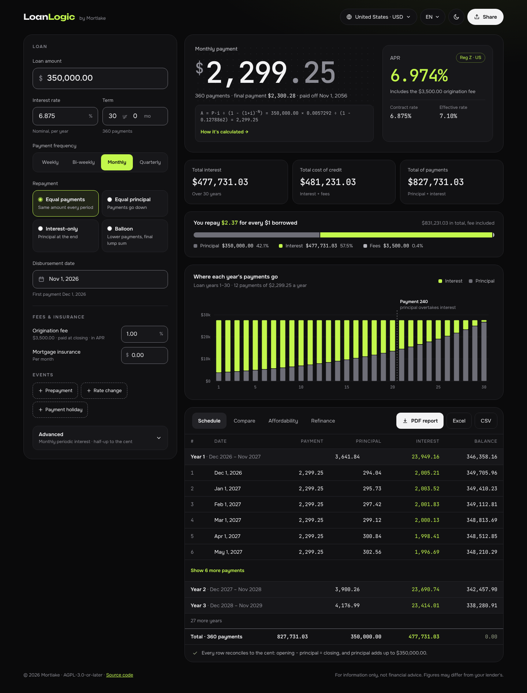
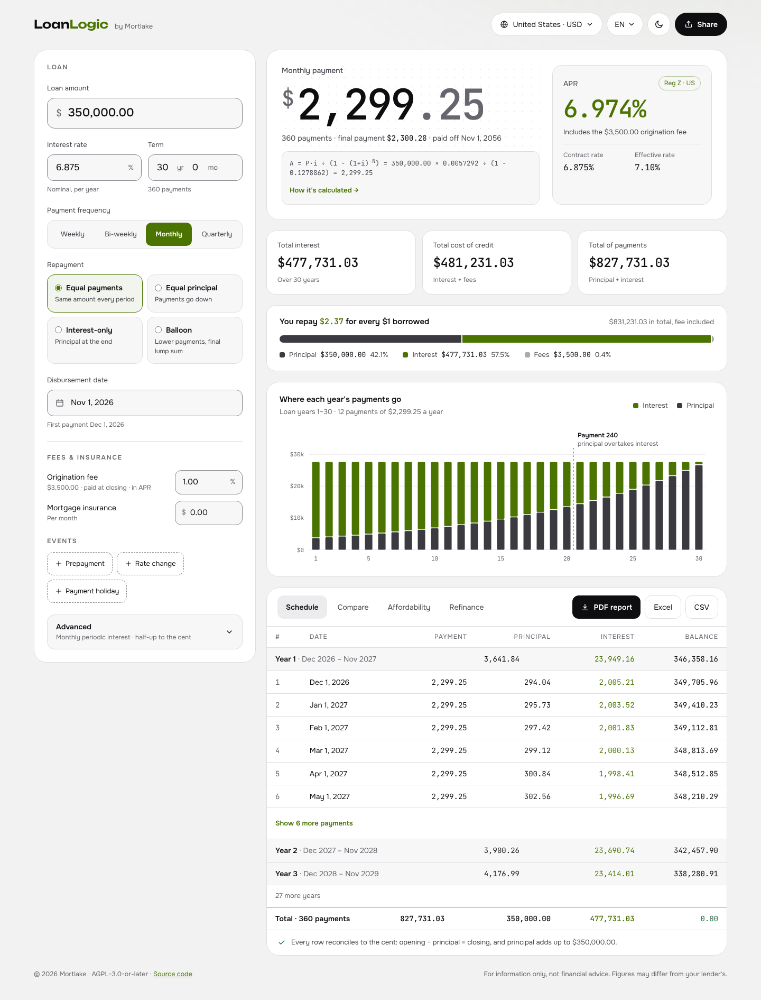
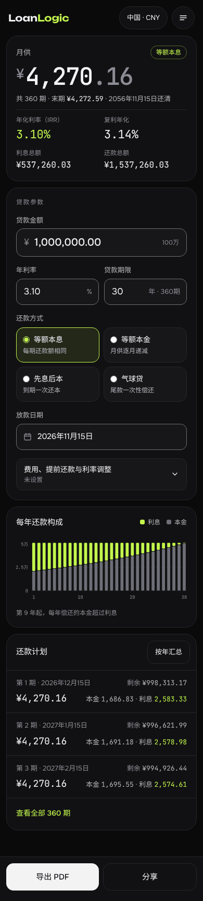
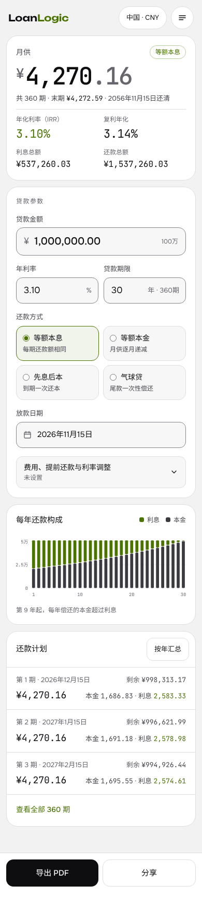

# LoanLogic — Design System ("Graphite Ledger")

Status: v1.0 · approved by the owner on 2026-10-19 (accent **A · lime**; fonts **Onest**,
**JetBrains Mono**, **Unbounded** for the wordmark). Normative for all UI work from T03
on. If an implementation and this document disagree, this document wins; if it is
ambiguous, the implementer stops and asks.

Reference renders (final tokens, real figures from the engine's golden vectors):

| Desktop, dark | Desktop, light |
|---|---|
|  |  |

| Mobile 简体中文, dark | Mobile 简体中文, light |
|---|---|
|  |  |

The renders are targets for layout, hierarchy and density. Exact values (colors,
sizes, spacing) come from the tokens in §3–§6, not from measuring the pictures. Where a
render and this text differ, the text wins: the frequency control has six options in a
3 × 2 grid (§8.3), the language select shows endonyms ("English", not "EN"), and the
disbursement date is the browser's native date input, which displays in the browser's
locale (the formatted date belongs in the hint line).

---

## 1. Principles

1. **Numbers are the content.** Every amount and rate is set in JetBrains Mono with
   tabular figures, right-aligned in columns, exact to the minor unit. The UI around
   them stays quiet: graphite surfaces, gray text, thin borders.
2. **Monochrome plus one accent.** Black, graphite and grays carry the interface. The
   lime accent marks only: (a) interest and the cost of credit, (b) the selected option of
   a primary input, (c) keyboard focus, (d) links and "explain" actions. Primary buttons
   are monochrome (inverted text color). The accent never means "success", never fills
   large areas, never decorates.
3. **Show the math.** Every headline figure has a one-line formula with the substituted
   values and a "How it's calculated" action (PLAN A11, SPEC §0.4).
4. **Calm density.** Cards with 1 px borders and generous padding; no heavy shadows, no
   gradients on data; one soft accent glow on the page background.
5. **Accessible by default.** WCAG 2.2 AA in both themes (checked by `tokens.test.ts`),
   44 px touch targets, visible focus, information never by color alone, reduced motion.

## 2. Themes

- **Dark** is the default when the system has no preference; **System** (default
  setting) follows `prefers-color-scheme` live; **Light** is for daylight and print.
- Both themes share every token name; only values differ (§3).
- Page background: `--color-bg` plus one radial glow:
  `radial-gradient(1100px 520px at 88% -180px, var(--color-accent-subtle), transparent 70%)`
  on the page (not on cards). No glow in print or forced-colors mode.

## 3. Color

### 3.1 Semantic tokens

| Token | Dark | Light | Use |
|---|---|---|---|
| `--color-bg` | `#0A0A0B` | `#F2F2F3` | page background |
| `--color-surface-1` | `#111113` | `#FFFFFF` | cards and panels |
| `--color-surface-2` | `#17171A` | `#F7F7F8` | inputs, nested blocks, table group rows |
| `--color-surface-3` | `#222226` | `#ECECEE` | selected tab, hover fills |
| `--color-text-primary` | `#F3F3F4` | `#0E0E10` | values, headings |
| `--color-text-secondary` | `#B6B6BD` | `#46464D` | labels, body copy |
| `--color-text-muted` | `#8C8C95` | `#66666E` | hints, captions, units, currency symbols in hero numbers |
| `--color-border` | `#26262B` | `#DEDEE2` | card and table dividers (decorative) |
| `--color-border-strong` | `#6E6E77` | `#84848D` | input and control outlines (≥ 3:1) |
| `--color-accent` | `#C3F74C` | `#4A7300` | interest/cost values, selected option, links |
| `--color-accent-hover` | `#D5FA7E` | `#3D6000` | hovered links and accent actions |
| `--color-accent-subtle` | `#232819` | `#F1F4EB` | selected card background, page glow |
| `--color-accent-line` | `#556829` | `#BACA9E` | outline of accent pills (rate method badge) |
| `--color-on-accent` | `#0A0A0B` | `#FFFFFF` | text on an accent fill |
| `--color-button-primary-bg` | `#F3F3F4` | `#0E0E10` | primary buttons (monochrome) |
| `--color-button-primary-fg` | `#0A0A0B` | `#FFFFFF` | text on primary buttons |
| `--color-success` | `#63D18F` | `#187C49` | reconciliation check, "pass" |
| `--color-warning` | `#E7C35A` | `#8A5A00` | "warn" checks, warnings |
| `--color-danger` | `#F97770` | `#B63132` | errors, "fail" checks |
| `--color-info` | `#8CB8F2` | `#1D5D97` | neutral notices |
| `--color-focus-ring` | `#C3F74C` | `#4A7300` | focus outline |
| `--color-chart-principal` | `#6E6E77` | `#3A3A40` | principal series |
| `--color-chart-interest` | `#C3F74C` | `#4A7300` | interest series (= accent) |
| `--color-chart-fees` | `#B6B6BD` | `#8C8C95` | fees and insurance series |
| `--color-chart-grid` | `#222226` | `#E9E9EC` | grid lines, dotted hero background |
| `--color-chart-axis` | `#8C8C95` | `#66666E` | axis labels |

Contrast is verified for: all text tokens and the accent on every surface (≥ 4.5:1),
`--color-on-accent` on the accent and `--color-button-primary-fg` on its background
(≥ 4.5:1), border-strong and focus ring on every surface (≥ 3:1), status colors on `bg`
and `surface-1` (≥ 4.5:1), chart series on `surface-1` (≥ 3:1). T03 extends
`tokens.test.ts` with the new tokens and the chart rule.

### 3.2 `tokens.css` (values for T03)

Token names and the three-block structure stay as in T01. Add the new primitives and
semantic tokens; replace values as below (unchanged scales are omitted).

```css
:root {
  --neutral-0: #000000;
  --neutral-50: #0a0a0b;
  --neutral-75: #0e0e10;
  --neutral-100: #111113;
  --neutral-150: #17171a;
  --neutral-200: #222226;
  --neutral-250: #26262b;
  --neutral-300: #3a3a40;
  --neutral-350: #46464d;
  --neutral-400: #66666e;
  --neutral-450: #6e6e77;
  --neutral-500: #84848d;
  --neutral-550: #8c8c95;
  --neutral-600: #a9a9b1;
  --neutral-700: #b6b6bd;
  --neutral-800: #dedee2;
  --neutral-850: #e9e9ec;
  --neutral-875: #ececee;
  --neutral-900: #f2f2f3;
  --neutral-925: #f3f3f4;
  --neutral-950: #f7f7f8;
  --neutral-1000: #ffffff;

  /* Accent A · lime. */
  --accent-100: #f1f4eb;
  --accent-200: #d5fa7e;
  --accent-300: #c3f74c;
  --accent-400: #556829;
  --accent-600: #baca9e;
  --accent-700: #4a7300;
  --accent-800: #3d6000;
  --accent-900: #232819;

  --green-300: #63d18f;
  --green-700: #187c49;
  --amber-300: #e7c35a;
  --amber-700: #8a5a00;
  --red-300: #f97770;
  --red-700: #b63132;
  --blue-300: #8cb8f2;
  --blue-700: #1d5d97;
}

:root,
:root[data-theme='dark'] {
  --color-bg: var(--neutral-50);
  --color-surface-1: var(--neutral-100);
  --color-surface-2: var(--neutral-150);
  --color-surface-3: var(--neutral-200);
  --color-text-primary: var(--neutral-925);
  --color-text-secondary: var(--neutral-700);
  --color-text-muted: var(--neutral-550);
  --color-border: var(--neutral-250);
  --color-border-strong: var(--neutral-450);
  --color-accent: var(--accent-300);
  --color-accent-hover: var(--accent-200);
  --color-accent-subtle: var(--accent-900);
  --color-accent-line: var(--accent-400);
  --color-on-accent: var(--neutral-50);
  --color-button-primary-bg: var(--neutral-925);
  --color-button-primary-fg: var(--neutral-50);
  --color-success: var(--green-300);
  --color-warning: var(--amber-300);
  --color-danger: var(--red-300);
  --color-info: var(--blue-300);
  --color-focus-ring: var(--accent-300);
  --color-chart-principal: var(--neutral-450);
  --color-chart-interest: var(--accent-300);
  --color-chart-fees: var(--neutral-700);
  --color-chart-grid: var(--neutral-200);
  --color-chart-axis: var(--neutral-550);
}

:root[data-theme='light'] {
  --color-bg: var(--neutral-900);
  --color-surface-1: var(--neutral-1000);
  --color-surface-2: var(--neutral-950);
  --color-surface-3: var(--neutral-875);
  --color-text-primary: var(--neutral-75);
  --color-text-secondary: var(--neutral-350);
  --color-text-muted: var(--neutral-400);
  --color-border: var(--neutral-800);
  --color-border-strong: var(--neutral-500);
  --color-accent: var(--accent-700);
  --color-accent-hover: var(--accent-800);
  --color-accent-subtle: var(--accent-100);
  --color-accent-line: var(--accent-600);
  --color-on-accent: var(--neutral-1000);
  --color-button-primary-bg: var(--neutral-75);
  --color-button-primary-fg: var(--neutral-1000);
  --color-success: var(--green-700);
  --color-warning: var(--amber-700);
  --color-danger: var(--red-700);
  --color-info: var(--blue-700);
  --color-focus-ring: var(--accent-700);
  --color-chart-principal: var(--neutral-300);
  --color-chart-interest: var(--accent-700);
  --color-chart-fees: var(--neutral-550);
  --color-chart-grid: var(--neutral-850);
  --color-chart-axis: var(--neutral-400);
}
```

Shadows are used only for floating layers (menus, popovers, sheets), never for cards:
dark `--shadow-2: 0 8px 24px rgb(0 0 0 / 0.5)`, `--shadow-3: 0 16px 48px rgb(0 0 0 / 0.55)`;
light `--shadow-2: 0 8px 24px rgb(14 14 16 / 0.1)`, `--shadow-3: 0 16px 48px rgb(14 14 16 / 0.14)`;
`--shadow-1: none` in both themes.

### 3.3 Accent budget

- Use the accent for: interest amounts (KPI, table column, cost bar, chart series), the
  headline cost-of-credit rate, the selected segment/card, focus, links and "explain"
  buttons, and the "Logic" half of the wordmark.
- Do not use it for: success states (green), totals that are not costs, icons, headings,
  borders of unselected controls, backgrounds larger than a selected control.
- One screen shows the accent on roughly 5 % of its area or less.

## 4. Typography

### 4.1 Families

| Token | Stack | Use |
|---|---|---|
| `--font-sans` | `'Onest Variable', system-ui, -apple-system, 'Segoe UI', Roboto, 'Helvetica Neue', Arial, 'PingFang SC', 'Hiragino Sans GB', 'Microsoft YaHei', 'Noto Sans CJK SC', sans-serif` | all UI text |
| `--font-sans-cjk` | `'Onest Variable', 'PingFang SC', 'Hiragino Sans GB', 'Microsoft YaHei', 'Noto Sans CJK SC', 'Noto Sans SC', 'Source Han Sans SC', system-ui, sans-serif` | `:lang(zh)` |
| `--font-mono` | `'JetBrains Mono Variable', ui-monospace, 'SF Mono', 'Cascadia Mono', 'Segoe UI Mono', Menlo, Consolas, monospace` | every amount, rate, count, date in tables, formulas |

- Packages (OFL-1.1, self-hosted): `@fontsource-variable/onest`,
  `@fontsource-variable/jetbrains-mono`. Load only the subsets the UI needs — Onest:
  latin, latin-ext, cyrillic, cyrillic-ext; JetBrains Mono: latin, latin-ext, cyrillic,
  cyrillic-ext (the ₴ sign U+20B4 is in cyrillic-ext). Chinese uses system fonts.
  Add both packages to `FONT_PACKAGES` in `scripts/lib/licenses.mjs` and remove Inter.
- **Unbounded is not shipped as a font.** The wordmark is the SVG in
  [`design/wordmark.svg`](design/wordmark.svg) (Unbounded 600 outlines, OFL-1.1;
  "Loan" uses `currentColor`, "Logic" is filled with `--color-accent` via CSS), and the
  favicon is [`design/favicon.svg`](design/favicon.svg).
- Numbers: `.num { font-family: var(--font-mono); font-variant-numeric: tabular-nums; }`.

### 4.2 Scale

Root 16 px; all sizes are `rem × --font-scale` (T01 structure). New tokens are marked.

| Token | Size | Weight / tracking | Use |
|---|---|---|---|
| `--font-size-xs` | 12 px | 400–600 | captions, hints, table headers (uppercase, 0.08em), section labels (uppercase, 600, 0.14em) |
| `--font-size-sm` | 14 px | 400–600 | labels, secondary text, buttons, table body |
| `--font-size-md` | 16 px | 400 | body text, inputs (prevents iOS zoom) |
| `--font-size-lg` | 18 px | 500 | mobile list amounts |
| `--font-size-xl` | 20 px | 500 | card titles on mobile |
| `--font-size-amount` (new) | 22 px | 500 mono | the loan-amount input |
| `--font-size-2xl` | 24 px | 500 mono, −0.02em | KPI values |
| `--font-size-4xl` | 36 px | 500 mono | reserved step (no v1 screen uses it) |
| `--font-size-rate` (new) | 46 px | 500 mono, −0.035em | regional rate on desktop |
| `--font-size-hero` (new) | `clamp(3rem, 2rem + 4vw, 5rem)` | 500 mono, −0.045em, line-height 1 | the payment |

Hero numbers render the currency symbol at 50 % size, raised and muted, and the minor
units muted: `$` `2,299` `.25`. The split uses `Intl.NumberFormat#formatToParts`, never
string slicing, so every locale and currency works (`¥4,270.16`, `12 345,67 ₴`).

Sentence case everywhere ("Monthly payment", not "Monthly Payment"); uppercase only for
xs section labels and table headers.

## 5. Space, size, shape

- Spacing: the T01 4 px scale (`--space-1` 4 px … `--space-16` 64 px). Card padding 24 px
  (desktop) / 16 px (mobile); gaps between cards 20 px / 12 px; between fields 22 px / 16 px.
- Radii (new values): `--radius-sm` 10 px (segments, chips), `--radius-md` 12 px (inputs,
  buttons, small cards), `--radius-lg` 18 px (KPI tiles, nested cards), `--radius-xl`
  24 px (panels), `--radius-full` pill.
- Control heights (new): `--size-control` 48 px (inputs), `--size-control-lg` 56 px (amount
  input), `--size-target` 44 px (minimum for every interactive element).
- Layout: `--layout-max-width` 86rem (1 376 px), `--layout-sidebar-width` 26.25rem
  (420 px), `--layout-gutter` `clamp(1rem, 4vw, 2rem)`.
- Borders: 1 px everywhere; dashed `--color-border-strong` for "add" buttons.

## 6. Motion

- Durations: `--duration-fast` 120 ms (hover, press), `--duration-normal` 200 ms
  (disclosure, tabs), `--duration-slow` (new) 320 ms (chart bars on first render).
- Changed numbers: a 160 ms fade-and-rise of 4 px, never a counting animation (a counter
  shows wrong intermediate amounts).
- `prefers-reduced-motion: reduce` sets all durations to 0 (T01 rule), including the new
  `--duration-slow`.

## 7. Layout

### 7.1 Desktop (≥ 64rem)

- Header: wordmark (22 px high) + "by Mortlake" (xs, muted) left; right: region and
  currency pill (globe icon, "United States · USD"; T05), language select (endonyms),
  theme button, **Share** (primary button). The theme button opens a menu (System, Dark,
  Light): a click, Enter or Space applies the choice and closes the menu, the arrow keys
  only move between the options, and Esc closes it; focus returns to the button.
- Two columns: the inputs panel (≤ 420 px) and the results column. The panel is sticky
  at the top with `max-height: calc(100dvh − 3rem)` and scrolls on its own
  (`overflow-y: auto`), so Fees and Advanced are reachable without scrolling the page.
- Results column, top to bottom: payment hero with the regional-rate card → KPI tiles →
  cost structure → chart (T04) → tabbed card with the schedule, later Compare,
  Affordability, Refinance (only implemented tabs are shown).
- Footer: "© 2026 Mortlake · AGPL-3.0-or-later · Source code" left; the disclaimer right.

### 7.2 Mobile (< 64rem, designed at 360–390 px)

- Header: wordmark (18 px high), the region pill and a menu button; language, theme,
  share and "About" live in the menu sheet.
- Order: summary card (payment, headline rate, the secondary rate of §8.7, total
  interest, total of payments) → inputs card (advanced settings, fees and events behind one
  disclosure with a status line such as "Not set") → chart → schedule as a list.
- When the summary card scrolls out of view, a compact bar sticks to the top: payment
  and headline rate (PLAN K2). The bottom action bar (Export PDF, Share) is sticky.
  `scroll-padding-top` and `scroll-padding-bottom` equal the heights of the sticky bars,
  so a focused control is never hidden behind them (WCAG 2.2 SC 2.4.11).
- Schedule list item: "No. 1 · Dec 15, 2026" + remaining balance (muted) on the first
  line; payment (lg, mono) and "Principal … · Interest …" (interest in accent) on the
  second; "Yearly summary" toggle in the card header; "Show all 360 payments".
- No horizontal scroll at 360 px in any language.

## 8. Components

### 8.1 Buttons

| Variant | Look | Use |
|---|---|---|
| Primary | `--color-button-primary-bg`, fg text, 600 | one per area: Share, PDF report, Export |
| Secondary | transparent, 1 px `--color-border`, primary text | Excel, CSV, filters |
| Accent text | no border, accent text, 600 | Explain, "Show 6 more payments", "How it's calculated →" |
| Add | dashed 1 px `--color-border-strong`, plus icon | "+ Prepayment", "+ Fee" |
| Icon | 44 × 44, pill, 1 px `--color-border`, surface-1 | theme, menu |

Height 44 px, radius `--radius-md` (pills in the header use `--radius-full`), horizontal
padding 16 px, icon 16 px with 8 px gap. Disabled: 40 % opacity and no pointer events,
never a different color.

### 8.2 Inputs

- Label above (sm, secondary), field 48 px (`--size-control`), radius `md`, surface-2,
  1 px `--color-border-strong`; value in mono when numeric; prefix/suffix units (muted):
  `$`, `%`, `yr`, `mo`.
- Hint below (xs, muted) shows the derived value: "360 payments", "First payment
  Dec 1, 2026", "$3,500.00 · paid at closing · in APR".
- Focus: border `--color-accent` + 3 px ring `--color-accent-subtle` (and the standard
  focus outline for keyboard users).
- Error: border `--color-danger`, message below with an icon (xs, danger), `aria-invalid`
  and `aria-describedby`; the message is the localized engine error (SPEC §13).
- Numbers are typed in the user's locale (grouping and decimal separator) and parsed to
  the engine's decimal strings; the field reformats on blur, never while typing.
- The loan amount and its currency select are one group: a `fieldset` whose legend
  "Loan amount" is the visible label (§11); the select keeps the accessible name
  "Currency". Below 30rem the amount is 18 px so both fit side by side at 360 px.
- Currency options read "USD · US dollar": the code and the localized name from
  `Intl.DisplayNames`. When the browser has no name for a code (it returns the code, as
  for CLF or ZWG in some versions), the option shows the code alone, not "CLF · CLF".

### 8.3 Segmented control

- Solid variant (primary inputs, e.g. payment frequency): track surface-2 with 1 px
  border; the selected segment is an accent fill with `--color-on-accent` text, 600.
  Frequencies: a 3 × 2 grid (Weekly, Bi-weekly, Monthly / Quarterly, Semi-annual,
  Annual).
- Quiet variant (tabs, view switches): selected = surface-3 fill, primary text, 600, and
  `box-shadow: inset 0 -2px 0 var(--color-text-primary)` — the fill alone is too close to
  the track to mark the state (SC 1.4.11); no accent.
- Built on native radios (T01 pattern); arrow keys move; forced-colors uses Highlight.

### 8.4 Choice cards (repayment type)

2 × 2 grid; each card: visible radio + title (sm, 600) + one-line description (xs,
secondary); radius `lg`, surface-2, 1 px border. Selected: 1 px `--color-accent` border,
`--color-accent-subtle` background. Titles: Equal payments / Equal principal /
Interest-only / Balloon (zh-CN: 等额本息 / 等额本金 / 先息后本 / 气球贷).

A title never breaks inside a word without a hyphen. The cards are narrower than the ru
and uk titles of equal principal at most widths, so those strings carry soft hyphens
(U+00AD) at the syllable breaks: Диф-фе-рен-ци-ро-ван-ный, Ди-фе-рен-ці-йо-ва-ний. Soft
hyphens work in every browser; `hyphens: auto` depends on the browser's dictionaries.

### 8.5 Disclosure

Full-width button (min 56 px): title (sm, 600) + status line (xs, muted, e.g. "Monthly
periodic interest · half-up to the cent") + chevron; `aria-expanded`; content slides
open with `--duration-normal`.

### 8.6 Payment hero

- Label (sm, secondary) named after the frequency: "Monthly payment", "Weekly payment";
  for equal principal "First payment" with the range "→ last $…".
- Hero number (§4.2) over a dotted grid (`radial-gradient` dots in `--color-chart-grid`,
  16 px pitch).
- The hero is the engine's instalment: `A` for annuity and balloon, `first` for equal
  principal and interest-only. It is the principal and interest of one payment, so for
  interest-only it is the interest alone (`I₁`, principal 0), or `P + I₁` when the loan
  has one payment (`N = 1`). Periodic fees and insurance are not part of it; when payments
  carry them, the meta line adds "first payment $… with periodic fees" (or "with
  insurance").
- Meta line: "360 payments · final payment $2,300.28 · paid off Nov 1, 2056".
- Formula strip: surface-2 box, mono xs–sm, built from the engine's `explain` values
  (SPEC §9.6) so that it reproduces the result. The strip's result is the engine's own
  value (`A` or `first`), never recomputed in the UI, so it always equals the hero.
  Irrational operands are displayed with 10 significant digits, for display only. The
  accent action "How it's calculated →" opens the Explain sheet (§8.12). One branch per
  payload; the equal-principal and bullet branches need the SPEC v0.2.3 payloads, which
  task T03a adds to the engine:
  - The rate `i` (annuity and balloon, and `I₁` in periodic mode): when the payload
    carries `i` (periodic interest with `c ≠ m`), its value is shown; otherwise `i` is
    shown as `j ÷ m` (periodic interest with `c = m`, and an annuity or balloon with the
    nominal payment basis in day-count mode). Day-count equal-principal and bullet
    payloads have no `i` and no `m`; their `I₁` uses `yf1` (below).
  - `instalment.annuity`: `A = P·i ÷ (1 − (1+i)^−N)`, e.g.
    `A = P·i ÷ (1 − (1+i)^−N), i = 0.06875 ÷ 12, N = 360 → 2,299.25`.
  - `instalment.balloon`: `A = (P − Bal·(1+i)^−N)·i ÷ (1 − (1+i)^−N)`.
  - `instalment.annuity-exact-basis`: there is no single `i`. The strip names the rate
    per period, `r_k = j × YF_k` with the day-count method (`dayCount`), and shows `P`,
    `N` → `A`.
  - The first period's interest `I₁` (equal principal, interest-only): `I₁ = P × j × YF₁`
    in day-count mode (the payload carries `yf1`); in periodic mode `I₁ = P × i` when the
    payload carries `i`, else `I₁ = P × j ÷ m`.
  - `instalment.equal-principal`: `q = R(P ÷ N)` (half-up to the minor unit, SPEC
    §5.3), then `first = p₁ + I₁`, where `p₁ = q`, or `p₁ = P − (N − 1)·q` when the
    remainder comes first.
  - `instalment.bullet`: `first = I₁`, or `first = P + I₁` when `N = 1`.

### 8.7 Regional rate card

- Title = the profile's headline method in the terms of `docs/GLOSSARY.md` §6 (APR,
  APR or APRC in the UK, APRC, 年化利率（单利）, Реальна річна процентна ставка,
  Effective all-in rate); badge pill with the source ("Reg Z · US", "FCA · UK", "EU",
  "PBOC", "НБУ"): 1 px `--color-accent-line`, accent text, xs.
- The rate in `--font-size-rate`, accent, with the method's precision (6.974%, 17.1%).
- One line on what it includes ("Includes the $3,500.00 origination fee").
- Divider, then a two-column `dl`: Contract rate, and the secondary rate — CN profile:
  年化利率（复利，IRR 法）(`irrEffective`, fees included); other profiles: Effective
  rate (without fees) (`effective`).

### 8.8 KPI tiles

Auto-fit grid (min 220 px), radius `lg`, surface-1: label (sm, secondary), value (2xl
mono), caption (xs, muted). Default set: Total interest (accent value), Total cost of
credit, Total of payments.

### 8.9 Cost structure

Heading "You repay **$2.37** for every $1 borrowed" (the ratio in accent mono) and the
total on the right; a 14 px pill bar split principal / interest / fees with 2 px gaps;
legend with swatch, label, amount (mono) and percent. The bar is `role="img"` with an
`aria-label` listing the parts.

- Figures (engine summary, SPEC §8.2): principal = `amount`, interest = `totalInterest`,
  fees = `totalFees + totalInsurance`, total = `totalPaid` (they add up exactly; a
  financed fee is counted once). Ratio = `totalPaid ÷ amount`, half-up to 2 decimals,
  formatted with 2 fraction digits whatever the currency's minor units (¥2.37, not ¥2).
- The bar is an SVG; the interest segment carries a subtle diagonal hatch in every mode,
  so principal and interest differ by more than color (SC 1.4.1). In forced-colors mode
  it uses `forced-color-adjust: none` with system colors (CanvasText, Highlight,
  GrayText) and keeps the hatch.

### 8.10 Schedule table

- Card header: quiet tabs on the left; PDF report (primary), Excel, CSV (secondary) on
  the right (exports arrive in T14–T15; hide until then).
- Columns: # · Date · Payment · Principal · Interest · Balance (+ Fees, Insurance,
  Extra when non-zero). Header xs uppercase muted; numbers right-aligned mono; the
  interest column in accent; the row index muted.
- Grouped by loan year: loan year y holds payments (y − 1)·m + 1 … y·m, counted by
  payment number, not by calendar year (for weekly loans the two differ). Group row on
  surface-2 ("Year 1 · Dec 2026 – Nov 2027") with subtotals of principal and interest and
  the closing balance. The first year is expanded with 6 rows and "Show 6 more
  payments"; years 2 and 3 are shown collapsed; then a "27 more years" button reveals
  the rest. Keyboard: group rows are buttons with `aria-expanded`.
- Footer row: "Total · 360 payments" with column totals (600) and closing 0.00 in
  `--color-success`.
- Reconciliation note under the table: success check icon + "Every row reconciles to
  the cent: opening − principal = closing, and principal adds up to $350,000.00." — shown
  only when the invariant checker passes (it always should; a failure is a bug report).
- Long schedules (1 200 rows) stay fast through grouping; virtualize only if a group
  exceeds 120 rows.

### 8.11 Charts (T04)

- Theme-aware SVG drawn with the chart tokens; no gradients; bars with 1.5 px radius and
  a 2 px gap between stacked segments; 1 px grid lines; axis labels xs mono in
  `--color-chart-axis`, compact notation from Intl ("$30K", "5万", "30 тыс.").
- Default chart: payments per loan year (§8.10), stacked principal (bottom) and interest
  (top); annotation at the first loan year whose principal exceeds its interest (dashed
  vertical line + label "Year 21 · principal overtakes interest"; one bar per payment
  and "Payment N" for loans shorter than 2 years). More views: balance over time,
  cumulative principal vs interest.
- Every chart has an `aria-label` summary and a "Show as table" alternative; hover and
  keyboard focus show a tooltip with exact values; no information by color alone
  (legend labels and the tooltip name each series).

### 8.12 Explain sheet

Side sheet (desktop, 480 px) or bottom sheet (mobile) with the formula id, the formula,
every substituted value (mono) and the result; for rates also the cash-flow summary and
the regulatory note (e.g. the Reg Z ±1/8 pp tolerance). Focus is trapped while open,
Esc closes, focus returns to the trigger.

### 8.13 Feedback states

- Validation: inline per field (§8.2). The results area never shows stale numbers:
  invalid input blanks the results at once (`aria-busy="true"`), and the message "Fix the
  highlighted fields" with the list of errors appears after 300 ms, so typing does not
  flash.
- Engine warnings (`RATE_HIGH`, `EARLY_CLOSE`, …) appear as an info/warning line under the
  hero with the localized explanation.
- Rate failures (`IRR_NO_CONVERGENCE`) show "n/a" with the reason as visible text beside
  it, not in a tooltip (a tooltip fails keyboard and touch users); a failed rate has no
  Explain button.

### 8.14 Checks (T11)

Rows on surface-2 with an icon (pass ✓ success, warn △ warning, fail ✕ danger), label,
value and the threshold ("31.7% ≤ 36%"); the source of the threshold in the tooltip.

## 9. Content and numbers

- All amounts through `formatMoney` with the engine's minor units (SPEC §1.2); tables
  omit the currency symbol and name the currency in the column header or caption.
- A value that displays as zero never shows a sign (`$0.00`, not `-$0.00`).
- Rates keep their method precision, trailing zeros included (6.500%, 17.1%).
- Dates: `formatDate` medium style; month-year labels via Intl (`Dec 2026`, `2026年12月`).
- zh-CN may show a 万/亿 hint next to large amounts (e.g. "100万"); the value itself keeps
  standard grouping.
- Copy is plain and short; financial terms follow `docs/GLOSSARY.md`; no exclamation
  marks; buttons are verbs.

## 10. Icons

Inline SVG, 24 px grid, 1.75–2 px stroke, round caps and joins, `currentColor`, drawn for
this project (no icon font, no remote assets). Set: globe, chevron-down, sun, moon,
monitor, share, download, calendar, plus, check, alert-triangle, x, info, menu,
arrow-right.

## 11. Accessibility checklist

- Contrast tokens as in §3.1, verified by tests in both themes.
- Focus: 2 px `--color-focus-ring` outline with 2 px offset on every interactive element.
- Interactive controls are at least 44 px high (`--size-target`); adjacent 44 px targets
  may touch (segments of a segmented control); inline text links are exempt (WCAG 2.2
  SC 2.5.8).
- Every input has a visible label; groups use `fieldset`/`legend`; errors are announced
  (`aria-live="polite"` for the results summary).
- Forced-colors mode keeps borders, focus and selected states (T01 rules).
- `prefers-reduced-motion` disables animation.
- axe: no serious or critical violations in both themes, at 360 and 1 280 px, in all four
  languages (T01 e2e pattern).

## 12. Supported browsers

Chrome and Edge 111+, Firefox 116+, Safari and iOS Safari 16.4+ (all released by
August 2023). This baseline covers BigInt, `Intl.NumberFormat` v3 (`signDisplay:
'negative'`, `roundingMode`), `color-mix()` and `:focus-visible`.

- From T03 on, Vite's `build.target` and `build.cssTarget` are
  `['chrome111', 'edge111', 'firefox116', 'safari16.4']`, and `eslint-plugin-compat`
  (MIT) checks API use against the same list (`browserslist` in `package.json`).
- Not allowed without a fallback: the HTML `popover` attribute (Chrome 114, Firefox 125,
  Safari 17), CSS nesting in source files (Chrome 112, Firefox 117, Safari 16.5),
  `Object.groupBy` / `Map.groupBy`, and `for await` over streams (Chrome 124; not in
  Safari 16.4). Newer CSS such as `:has()` (Firefox 121) is a progressive enhancement
  only.
- The "unsupported browser" notice comes in T18.

## 13. Assets

| File | Content | License |
|---|---|---|
| `design/wordmark.svg` | wordmark outlines (Unbounded 600) | outlines from Unbounded, OFL-1.1, © The Unbounded Project Authors; the wordmark is a document made with the font |
| `design/favicon.svg` | "L" monogram, lime on black | as above |
| `design/concept-*.png` | reference renders | AGPL-3.0-or-later, © 2026 Mortlake |
